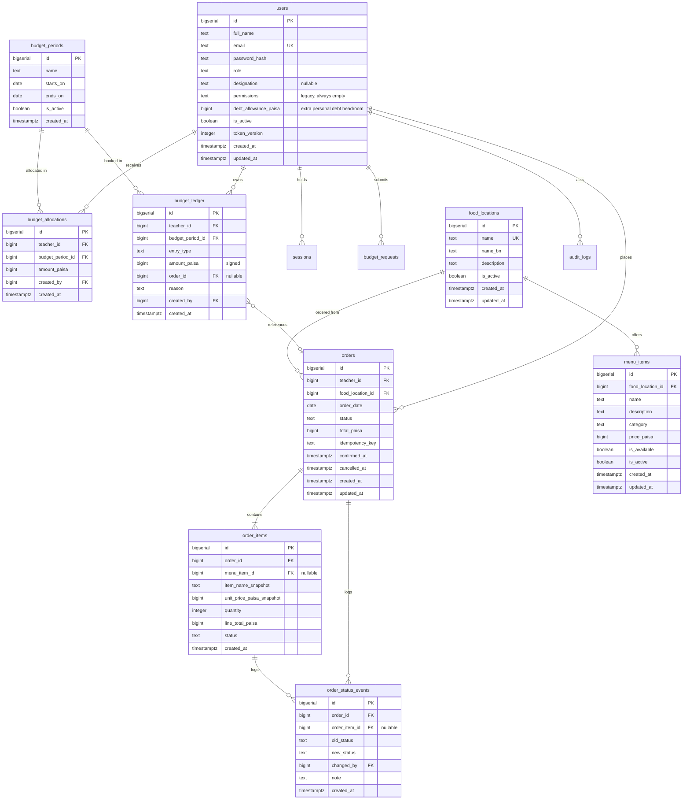

# Database Reference

Schema design, conventions, and the migration process.

> **সংক্ষিপ্ত:** এখানে ডেটাবেসের সব টেবিল, কলাম, সম্পর্ক, এবং নিয়মগুলো লেখা আছে।

## Conventions

| Concern                    | Rule                                                                                                           |
| -------------------------- | -------------------------------------------------------------------------------------------------------------- |
| Money                      | `bigint` holding integer paisa. ৳1 = 100 paisa. Never `float` or `numeric` with a scale for arithmetic         |
| Timestamps                 | `timestamptz`, written in UTC                                                                                  |
| Business dates             | `date`, holding the `Asia/Dhaka` calendar day                                                                  |
| Primary keys               | `bigserial` for entities, `uuid` for sessions                                                                  |
| Naming                     | `snake_case` tables and columns; `created_at` / `updated_at` on every mutable table                            |
| Soft deletion              | `is_active boolean` on locations and menu items. Historical tables are never deleted                           |
| Enumerations               | `text` with a `CHECK` constraint. No native PostgreSQL enum types, so adding a value is not a migration hazard |
| Deletion of financial data | Not supported at any permission level                                                                          |

## Entity relationships



## Tables

### `users`

Every teacher, staff member, and administrator.

| Column                      | Type          | Notes                                                                                                                               |
| --------------------------- | ------------- | ----------------------------------------------------------------------------------------------------------------------------------- |
| `id`                        | `bigserial`   | Primary key                                                                                                                         |
| `full_name`                 | `text`        | Required                                                                                                                            |
| `email`                     | `text`        | Required, **unique**, stored lower-cased                                                                                            |
| `password_hash`             | `text`        | bcrypt hash, always with the `$2b$` prefix. Plaintext is never stored or logged                                                     |
| `role`                      | `text`        | `TEACHER`, `STAFF`, or `ADMIN`, enforced by a `CHECK` constraint                                                                    |
| `designation`               | `text`        | Academic or staff designation (e.g. Professor, Lecturer). Nullable                                                                  |
| `permissions`               | `jsonb`       | Legacy column, always `[]`. Access is purely role-based; kept only so old data retains meaning                                      |
| `debt_allowance_paisa`      | `bigint`      | Extra debt headroom granted on top of the global `max_debt_paisa` policy, typically via an approved budget request. Defaults to `0` |
| `is_active`                 | `boolean`     | A deactivated user cannot log in and their tokens stop working                                                                      |
| `token_version`             | `integer`     | Embedded in every JWT. Incrementing it revokes all of that user's tokens                                                            |
| `created_at` / `updated_at` | `timestamptz` |                                                                                                                                     |

Indexes: unique on `email`, index on `role` for staff listings.

### `sessions`

Login audit trail and refresh-token storage. The primary authentication
mechanism is the JWT; this table records logins and supports revocation.

| Column          | Type          | Notes                                                   |
| --------------- | ------------- | ------------------------------------------------------- |
| `id`            | `uuid`        | Primary key                                             |
| `user_id`       | `bigint`      | Foreign key to `users`, `ON DELETE CASCADE`             |
| `token_version` | `integer`     | Value at issue time. A mismatch invalidates the session |
| `ip_address`    | `inet`        | Recorded for abuse investigation                        |
| `user_agent`    | `text`        |                                                         |
| `expires_at`    | `timestamptz` |                                                         |
| `revoked_at`    | `timestamptz` | Nullable. Set on logout                                 |
| `created_at`    | `timestamptz` |                                                         |

### `food_locations`

Participating vendors. The CRUD demonstration entity for this project.

| Column                      | Type          | Notes                                 |
| --------------------------- | ------------- | ------------------------------------- |
| `id`                        | `bigserial`   | Primary key                           |
| `name`                      | `text`        | Required, unique                      |
| `name_bn`                   | `text`        | Bengali display name                  |
| `description`               | `text`        |                                       |
| `is_active`                 | `boolean`     | Soft deactivation. Never hard-deleted |
| `created_at` / `updated_at` | `timestamptz` |                                       |

### `menu_items`

| Column                      | Type          | Notes                                        |
| --------------------------- | ------------- | -------------------------------------------- |
| `id`                        | `bigserial`   | Primary key                                  |
| `food_location_id`          | `bigint`      | Foreign key, `ON DELETE RESTRICT`            |
| `name`                      | `text`        | Required                                     |
| `description`               | `text`        |                                              |
| `category`                  | `text`        | Optional grouping such as `lunch` or `snack` |
| `price_paisa`               | `bigint`      | `CHECK (price_paisa > 0)`                    |
| `is_available`              | `boolean`     | Orderable right now                          |
| `is_active`                 | `boolean`     | Soft deactivation                            |
| `created_at` / `updated_at` | `timestamptz` |                                              |

Indexes: `(food_location_id, is_available)` for menu browsing.

### `budget_periods`

A budget window. Weekly by default; the table supports any window.

| Column       | Type          | Notes                                 |
| ------------ | ------------- | ------------------------------------- |
| `id`         | `bigserial`   | Primary key                           |
| `name`       | `text`        | Display label, for example `2026-W42` |
| `starts_on`  | `date`        | `CHECK (ends_on >= starts_on)`        |
| `ends_on`    | `date`        |                                       |
| `is_active`  | `boolean`     |                                       |
| `created_at` | `timestamptz` |                                       |

Periods must not overlap. Enforced by an exclusion constraint using `daterange`.

### `budget_allocations`

The intended amount for a teacher in a period.

| Column             | Type          | Notes                                               |
| ------------------ | ------------- | --------------------------------------------------- |
| `id`               | `bigserial`   | Primary key                                         |
| `teacher_id`       | `bigint`      | Foreign key to `users`                              |
| `budget_period_id` | `bigint`      | Foreign key to `budget_periods`                     |
| `amount_paisa`     | `bigint`      | `CHECK (amount_paisa >= 0)`                         |
| `created_by`       | `bigint`      | Foreign key to `users`, the allocating staff member |
| `created_at`       | `timestamptz` |                                                     |

**Unique constraint** on `(teacher_id, budget_period_id)`. This is what enforces
policy P4: a duplicate allocation is rejected, and changing an amount requires
an explicit adjustment with a reason.

### `budget_ledger`

Append-only. Every financial movement for every teacher. **This table is the
source of truth for balances.**

| Column             | Type          | Notes                                            |
| ------------------ | ------------- | ------------------------------------------------ |
| `id`               | `bigserial`   | Primary key                                      |
| `teacher_id`       | `bigint`      | Foreign key to `users`                           |
| `budget_period_id` | `bigint`      | Foreign key to `budget_periods`                  |
| `entry_type`       | `text`        | `allocation`, `debit`, `refund`, or `adjustment` |
| `amount_paisa`     | `bigint`      | **Signed.** Credits positive, debits negative    |
| `order_id`         | `bigint`      | Nullable foreign key to `orders`                 |
| `reason`           | `text`        | Required for `adjustment` and for staff refunds  |
| `created_by`       | `bigint`      | Foreign key to `users`                           |
| `created_at`       | `timestamptz` |                                                  |

**Sign convention.** Credits are positive, debits are negative. Available
balance for a teacher in a period is:

```sql
SELECT COALESCE(SUM(amount_paisa), 0)
FROM budget_ledger
WHERE teacher_id = $1 AND budget_period_id = $2;
```

There is deliberately **no stored balance column**. A mutable balance can drift
from the ledger through a single missed write; a `SUM` cannot. The ledger is
append-only and rows are never updated or deleted.

### `budget_requests`

Teacher requests for additional budget or extra personal debt allowance,
approved or rejected by an administrator.

| Column         | Type          | Notes                                                                                                            |
| -------------- | ------------- | ---------------------------------------------------------------------------------------------------------------- |
| `id`           | `bigserial`   | Primary key                                                                                                      |
| `teacher_id`   | `bigint`      | Foreign key to `users`                                                                                           |
| `request_type` | `text`        | `budget_increase` (adds to the current month's budget) or `debt_allowance` (raises `users.debt_allowance_paisa`) |
| `amount_paisa` | `bigint`      | Positive, enforced by a `CHECK` constraint                                                                       |
| `reason`       | `text`        | Why the teacher needs it                                                                                         |
| `status`       | `text`        | `pending`, `approved`, or `rejected`                                                                             |
| `decided_by`   | `bigint`      | Nullable foreign key to `users`, the deciding administrator                                                      |
| `decided_at`   | `timestamptz` | Nullable                                                                                                         |
| `created_at`   | `timestamptz` |                                                                                                                  |

Approving a `budget_increase` writes a positive `adjustment` ledger entry for
the teacher's current Dhaka month. Approving a `debt_allowance` increments the
teacher's `debt_allowance_paisa`, which the order-placement debt check adds on
top of the global `max_debt_paisa` policy.

### `orders`

| Column                                            | Type          | Notes                                                                           |
| ------------------------------------------------- | ------------- | ------------------------------------------------------------------------------- |
| `id`                                              | `bigserial`   | Primary key                                                                     |
| `teacher_id`                                      | `bigint`      | Foreign key to `users`                                                          |
| `food_location_id`                                | `bigint`      | Foreign key. One location per order, per policy P2                              |
| `order_date`                                      | `date`        | The `Asia/Dhaka` business date                                                  |
| `status`                                          | `text`        | `CONFIRMED`, `COLLECTED`, `DELIVERED`, `CANCELLED`                              |
| `total_paisa`                                     | `bigint`      | Server-calculated; updated to the actual cost when a delivery is reconciled     |
| `idempotency_key`                                 | `text`        | Nullable                                                                        |
| `alternative_item_name`                           | `text`        | Nullable. The fallback dish the teacher declared, or what staff actually served |
| `alternative_unit_price_paisa`                    | `bigint`      | Nullable. Declared unit price of the alternative dish                           |
| `actual_cost_paisa`                               | `bigint`      | Nullable. Actual delivered cost, set when delivery is reconciled                |
| `delivery_confirmed_at` / `delivery_confirmed_by` |               | Nullable. Set when the order is marked delivered                                |
| `confirmed_at`                                    | `timestamptz` |                                                                                 |
| `cancelled_at`                                    | `timestamptz` | Nullable                                                                        |
| `created_at` / `updated_at`                       | `timestamptz` |                                                                                 |

**Unique constraint** on `(teacher_id, idempotency_key)` where the key is not
null. This is what prevents a double-click or a network retry from creating two
orders and two debits. The client generates the key once per checkout attempt.

Indexes: `(order_date, status)` for the staff daily view, `(teacher_id,
order_date)` for teacher history.

### `order_items`

| Column                      | Type          | Notes                                                          |
| --------------------------- | ------------- | -------------------------------------------------------------- |
| `id`                        | `bigserial`   | Primary key                                                    |
| `order_id`                  | `bigint`      | Foreign key, `ON DELETE CASCADE`                               |
| `menu_item_id`              | `bigint`      | Nullable foreign key. Retained even if the item is deactivated |
| `item_name_snapshot`        | `text`        | Name at the time of ordering                                   |
| `unit_price_paisa_snapshot` | `bigint`      | Price at the time of ordering                                  |
| `quantity`                  | `integer`     | `CHECK (quantity > 0)`                                         |
| `line_total_paisa`          | `bigint`      | `unit_price_paisa_snapshot * quantity`                         |
| `status`                    | `text`        | Item-level collection state                                    |
| `notes`                     | `text`        |                                                                |
| `created_at`                | `timestamptz` |                                                                |

The two snapshot columns satisfy policy P7. A later menu price change must not
rewrite history, so nothing in the reporting path ever joins back to
`menu_items.price_paisa` to recompute a historical total.

### `order_status_events`

Append-only history of every status transition, at order level or item level.

| Column          | Type          | Notes                                 |
| --------------- | ------------- | ------------------------------------- |
| `id`            | `bigserial`   | Primary key                           |
| `order_id`      | `bigint`      | Foreign key to `orders`               |
| `order_item_id` | `bigint`      | Nullable foreign key to `order_items` |
| `old_status`    | `text`        | Nullable for the first transition     |
| `new_status`    | `text`        |                                       |
| `changed_by`    | `bigint`      | Foreign key to `users`                |
| `note`          | `text`        |                                       |
| `created_at`    | `timestamptz` |                                       |

### `audit_logs`

Administrative actions outside ordinary order flow.

| Column          | Type          | Notes                                                              |
| --------------- | ------------- | ------------------------------------------------------------------ |
| `id`            | `bigserial`   | Primary key                                                        |
| `actor_user_id` | `bigint`      | Nullable foreign key to `users`                                    |
| `action`        | `text`        | For example `budget.allocation.created`, `menu_item.price.updated` |
| `entity_type`   | `text`        |                                                                    |
| `entity_id`     | `bigint`      | Nullable                                                           |
| `metadata`      | `jsonb`       | Must never contain passwords, hashes, or tokens                    |
| `created_at`    | `timestamptz` |                                                                    |

### `app_settings`

Configuration that staff may change without a deployment.

| Column        | Type          | Notes                           |
| ------------- | ------------- | ------------------------------- |
| `key`         | `text`        | Primary key                     |
| `value`       | `jsonb`       |                                 |
| `description` | `text`        |                                 |
| `updated_by`  | `bigint`      | Nullable foreign key to `users` |
| `updated_at`  | `timestamptz` |                                 |

Seeded keys: `order_cutoff_time` (default `12:00`), `budget_rollover` (default
`false`), `timezone` (default `Asia/Dhaka`).
When rollover is enabled, creating a period credits each active teacher's
positive remaining balance from the immediately preceding period as a signed
`adjustment` ledger entry in the new period. Period creation and rollover credits
commit or roll back together.

## What the database enforces, and what it cannot

Most rules live in the schema as constraints, triggers, or unique indexes, so a
service, a script, or a future endpoint cannot quietly bypass them: the append-only
ledger, non-overlapping budget periods, one allocation per teacher per period,
case-insensitive unique email, idempotent orders, positive prices and quantities,
`line_total_paisa` equal to unit price times quantity, and `cancelled_at` present
exactly when an order is cancelled.

Two rules are **not** enforceable this way and are stated here so nobody assumes
otherwise:

- **`orders.total_paisa` equals the sum of its line items.** A `CHECK`
  constraint cannot span rows. The order service computes both inside one
  transaction, and the seed test asserts the invariant across all seeded data.
- **One food location per order.** Only the service layer can see every line item
  at once, so it validates this before writing.

## Truncating and `app_settings`

`TRUNCATE ... CASCADE` follows every foreign key pointing at the truncated
tables. Because `app_settings.updated_by` references `users`, truncating `users`
also empties `app_settings`. Both the seed script and the test helper restore the
settings defaults immediately afterwards, so neither leaves the database
unconfigured. Any future reset script must do the same.

## int8 and money

Every money column is `bigint`. `node-postgres` returns int8 as a string by
default, which would contradict the API contract of an integer `amountPaisa`.
`server/src/db/int8.ts` installs a type parser that converts int8 to a number,
and it is imported by both the application pool and the test pool, because the
parser is process-wide. Paisa amounts are many orders of magnitude below
`Number.MAX_SAFE_INTEGER`, so this is exact.

Two operations must be atomic. If either half fails, both roll back, so an order
can never exist without its ledger debit, and a debit can never exist without its
order.

**Order creation** runs at `SERIALIZABLE` isolation:

1. Begin transaction.
2. `SELECT ... FROM users WHERE id = $1 FOR UPDATE` — lock the teacher row. This
   serialises concurrent orders by the same teacher so two simultaneous requests
   cannot both read the same balance and both succeed.
3. Check ordering is open for the date and the cutoff has not passed.
4. Load the requested menu items and verify availability, active state, and
   quantity bounds.
5. Calculate the total from database prices.
6. Sum the ledger for the teacher's period and verify sufficient balance.
7. Insert the order, insert the order items, insert the ledger debit.
8. Commit.

**Cancellation** opens a transaction, marks the order cancelled, inserts the
matching positive ledger refund, and appends a status event.

## Migration runner

There is no ORM, so `db/migrate.ts` implements migrations directly.

- Migrations are numbered SQL files in `db/migrations/`, applied in filename
  order. `0001_initial_schema.sql`, `0002_...`, and so on.
- Each file runs inside a transaction and is recorded in `schema_migrations`
  with a checksum.
- A **PostgreSQL advisory lock** is held for the duration of the run, so two
  concurrent deployments cannot apply migrations simultaneously.
- On start-up the runner verifies that every applied migration's checksum still
  matches its file. A mismatch means an already-applied migration was edited,
  which is a hard failure rather than a silent drift.
- `db:migrate` applies pending migrations. `db:migrate:status` reports what has
  and has not been applied without changing anything.

Editing a migration that has already been applied is not permitted. Add a new
migration instead.

## Seed data

`db/seed.sql` loads fictional demonstration data and is safe to run repeatedly:
it truncates the demo tables first, so the seed always produces the same result.

It creates two locations, a representative menu with realistic-looking paisa
prices, three budget periods, fictional teacher and staff accounts, and a few
past orders with matching ledger entries so the reports have something to show.

**Every seeded record is fictional.** Restaurant names are illustrative. Prices
are not verified real-world prices and must be confirmed before production use.
No real teacher personal data is ever seeded.
